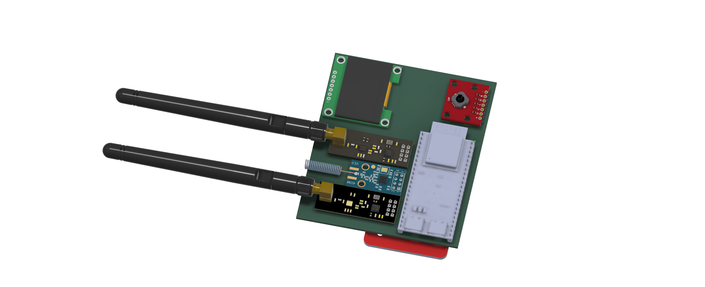
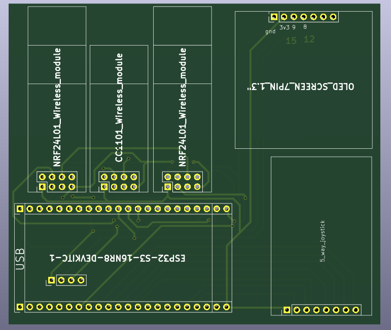
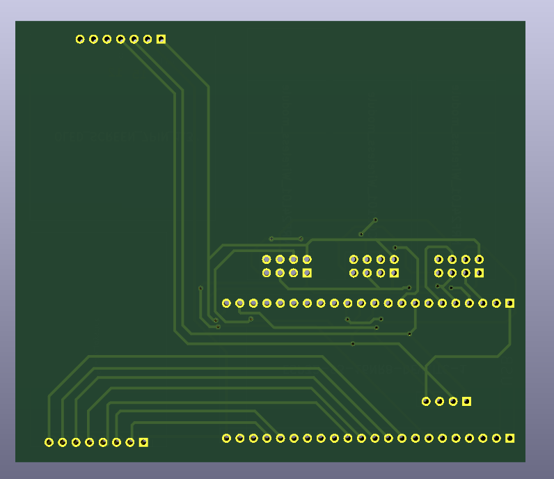

# Cyber-Swiss-Knife
A Custom hacking/testing and a cool tool that can be used as a watch and a NFC key for such things as cards, scooters etc. it has security systems and a ESP32-S3-N16R8  on it.


## Required Library Setup
### Open Arduino IDE and install the following libraries via Tools -> Manage Libraries:

1-Adafruit SSD1306 (by Adafruit)

2-Adafruit GFX Library (by Adafruit)

3-RF24 (by TMRh20)

4-ELECHOUSE_CC1101_SRC_DRV (by Elechouse)

5-PN532 (by Seeed Studio)

6-esp32(by Espressif Systems)

### Required Library Setup for The schematics File:
Go to `/Libraries` and download the ZIP file Unzip it in a folder and then do the following order:
Open **Kicad** and the schematic file through there,
1. Go to Preferences -> Manage Symbol Libraries... in KiCad.
2. Choose Project Specific Libraries tab (only for the current project).
3. Click the Add existing library to table button (folder icon) at the bottom.
4. Browse to your unzipped folder and add the files

## Features

This Hacking tool works as a keychain on your bag, a watch, an nfc wallet and a  wireless connections trolling-tool.
1- You can scan/sniff high frequencies and reuse them, troll wifi and bluetooth connections.
2-You can use it as a NFC-Wallet for simple cards such as escooter, e bike and metro cards.
3-You can use it as a keychain! it looks Cool and works pretty well.
4-A watch! 

---

## Technical overview

It uses a ESP32-S3-N16R8 board as a main controller, a 1.3'' OLED screen for the menu and timer,a PN532 NFC reader for the NFC stuff,a CC1101 high-frequency antenna for higher frequencies, 2x NRF24L01+ Module for lower frequencies and radio, a 5-way mini joystick module for selecting the feature over the OLED screen, and a 3.7v 2000mah Li-po battery.

## Key Features

Multi Protocol Wireless Testing: Supports multiple frequency bands and wireless protocols (Wi-Fi, Bluetooth, Sub-GHz and NFC) to aid security testing.

High Performance Brain: With 16MB Flash and 8MB PSRAM, using the ESP32-S3-N16R8 there is more than enough space for big firmwares, custom scripts and great UI performance.

1.3" OLED Screen: Featuring a crisp screen to display live information about your networks, devices and menu.

5-way Joystick: Easily navigate the menu system with the 5-way Joystick.

Portable: With a built-in Li-Po battery this device is very portable with a Type-C charging system.

## Controls & Display
Navigation: Controlled using a 5-way joystick (Up, Down, Left, Right, Center/Select) allowing intuitive menu operation.

Display: A 1.3" I2C OLED acts as the primary visual interface for displaying system logs, network lists, and attack statuses, time, nfc keys etc.

## Hardware

The prototype currently uses:

|Component|
|---|
|ESP32-S3-N16R8 DevKit|
|1.3" Inch OLED Display (SH1106 / SSD1306)|
|5-Way Navigation Switch / Joystick Module|
|PN532 NFC / RFID Module|
|CC1101 Sub-GHz Transceiver Module|
|NRF24L01+ (PA+LNA) RF Module|
|3.7V Li-Po Battery(2000mah)|
|TP4056 Type-C Battery Charging Board(not included in the BOM)|


## PCB 

The PCB was designed in **KiCad**.

  

The repository contains:

- KiCad schematic
- KiCad PCB layout
- Gerber files
- Drill files
- BOM
- PCB production files

##  Schematics

 

The Schematics were designed in **Kicad**
If theres missing symbols, add The required Library In the Top ¨Required Library Setup for kicad¨


## 📁 Repository Structure

```text
Cyber-Swiss-Knife/
│
├── Firmware/
│   └── Firmware source
│
├── Images/
│   └── Project photos and renders
│
├── PCB/
│   ├── KiCad project
│   ├── Schematic
│   ├── PCB layout
│   |── BOM file
│
├── Production/
│   └── Gerber and drill files
│
└── README.md
